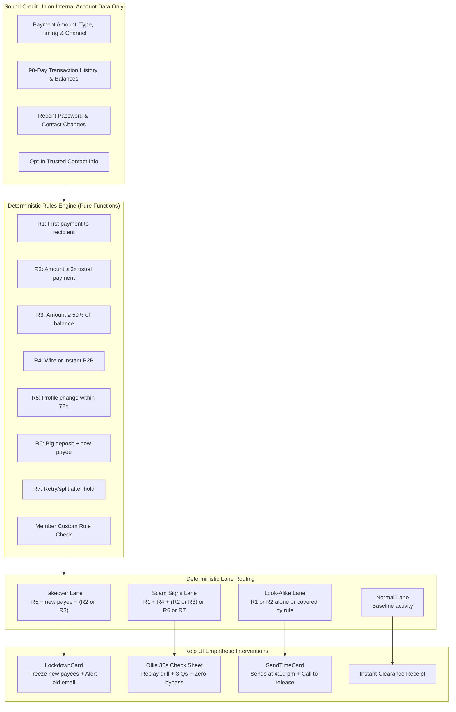

# Otterly Safe (HuskyHack 2026 Clickable Prototype)

> **"Otterly safe, every wave of life."**  
> *Sound Credit Union · UW Tacoma · HuskyHack 2026 Challenge: "Stop the scam before the money moves."*

🌐 **Live Deployed Prototype:** [https://otterly-safe.vercel.app/](https://otterly-safe.vercel.app/)  
💻 **GitHub Repository:** [https://github.com/Aayush1259/Otterly-Safe](https://github.com/Aayush1259/Otterly-Safe)


---

## 📌 What Otterly Safe Is

**Otterly Safe** is an in-app scam-protection capability embedded natively inside the **Sound Credit Union** mobile banking experience. Guided by **Ollie**, an empathetic sea otter mascot, Otterly Safe intercepts high-risk deception and coercion **before funds leave the member's account**.

Unlike conventional anti-fraud tools that rely on invasive device spyware, opaque third-party broker scores, or hostile blocking modals with easy "bypass" buttons, Otterly Safe adheres to **Kelp UI** ("calm, kind, clear"):

1. **Practice with Ollie:** 40-second micro-games built from official FTC scam alerts: *"Scam or legit?"* cards, an interactive security call role-play, a red-flag hunt, and quick quizzes. Members pre-commit protective rules (e.g. hold new payees over $1,000).
2. **The Ollie Check:** When deterministic rules detect scam manipulation on an outgoing transfer, the payment is paused **while funds remain 100% safe in the account**. A 30-second sheet replays the exact scam card the member already practiced, asks 3 targeted questions, and offers **Cancel · Wait 24 hours · Talk to Sound**. There is **no "send anyway" button** in this lane.
3. **Account Lockdown:** When takeover indicators emerge (password reset + phone/email changed at 2 am + immediate new payee transfer), new payees freeze instantly. A verification alert is sent to the contact info on file *prior* to the change. No quiz is shown, as the device may be held by the criminal.
4. **Legitimate Look-Alikes:** Members paying real contractors or new daycare providers receive a transparent schedule (*"Sends at 4:10 pm today, or call us to send now"*), one purpose question, and an option to save a custom rule (*"Contractor payments up to $6,000 won't pause"*).
5. **Missed Scams & Restorative Care:** When slow-burn manipulation evades initial rules (e.g. steady $300 transfers to a fake investment platform), Sound provides a **no-blame recovery path**: immediate ACH/wire recall requests, police/FTC documentation packages, and 90 days of tighter account settings.
6. **Sound Staff Console:** Branch and call-center staff receive unified case cards featuring a 3-line phone script, legal recall countdown clocks in plain text, member timelines, and 1-click decisioning (*Release, Keep holding, Escalate*).

---

## 🏗 System Architecture



---

## 📊 Deterministic Rules Table

| ID | Plain English Rule | Default Threshold | Lane Influence |
| :--- | :--- | :--- | :--- |
| **R1** | First payment to this recipient | New payee flag (`true`) | Contributes to Look-Alike & Scam signs |
| **R2** | Much bigger than member's usual payment | $\ge 3\times$ usual payment | Signals unusual financial displacement |
| **R3** | Uses up a large share of available balance | $\ge 50\%$ of balance | High severity loss exposure |
| **R4** | Hard to undo (instant settlement) | Wire or instant P2P | Elevates risk when paired with R1 + (R2\|R3) |
| **R5** | Password reset or phone/email changed | Within past 72 hours | Routes immediately to **Takeover** lane |
| **R6** | Large new deposit, then money out to new payee | Within past 72 hours ($\ge \$2,000$) | Catches fake-check employment scams |
| **R7** | Trying again after hold (split amount, type switch) | Any retry following a hold | Catches scammer coercion trying workarounds |
| **OWN** | Member custom rule (e.g. contractor limit) | Personalized amount / category | Softens Look-Alike lane (never softens Takeover/Scam) |

---

## 🚀 Live Demo & How to Run

### 🌐 Live Production Deployment
- **Live URL:** [https://otterly-safe.vercel.app/](https://otterly-safe.vercel.app/)
- **GitHub Repository:** [https://github.com/Aayush1259/Otterly-Safe](https://github.com/Aayush1259/Otterly-Safe)

### Local Prerequisites
- Node.js (v18 or v20+)
- npm or pnpm

### Quickstart
```bash
# Clone the repository
git clone https://github.com/Aayush1259/Otterly-Safe.git
cd Otterly-Safe

# Install dependencies (runs fully offline after install)
npm install

# Run Vitest unit tests (100% deterministic rules verification)
npm test

# Launch local development server
npm run dev
```
Open `http://localhost:5173` in your browser.

### Building for Production / Offline Demo
```bash
npm run build
npm run preview
```
The application compiles to a static distribution (`dist/`) requiring zero server-side runtimes. It is deployed on Vercel at [https://otterly-safe.vercel.app/](https://otterly-safe.vercel.app/) and can also be hosted on Netlify, GitHub Pages, or run fully offline from a local static server.

---

## 📂 Loading the Starter Kit

By default, Otterly Safe loads high-fidelity synthetic seed data generated across 10 member profiles, 740+ ledger transactions spanning 90 days, and 6 active case records.

To load official competition starter kit data:
1. Place the starter kit CSV or JSON files into the `/public/kit/` directory:
   - `/public/kit/members.csv`
   - `/public/kit/events.csv`
   - `/public/kit/cases.json`
   - `/public/kit/manifest.json` (optional manifest specifying column maps)
2. Otterly Safe's `/src/data/adapter.ts` will automatically detect and map the kit files on launch via `PapaParse`.
3. If no files are placed in `/public/kit/`, the app seamlessly falls back to `/src/data/seed.json`.

---

## ⌨️ Presenter & Staff Keyboard Shortcuts

### Global Demo Controls
- <kbd>→</kbd> : Advance scenario to next step
- <kbd>←</kbd> : Step back to previous step
- <kbd>R</kbd> : Reset current scenario
- <kbd>D</kbd> : Toggle raw ledger events data drawer

### Staff Console Controls
- <kbd>J</kbd> : Move down case queue
- <kbd>K</kbd> : Move up case queue
- <kbd>1</kbd> : Release payment
- <kbd>2</kbd> : Keep holding payment
- <kbd>3</kbd> : Escalate case to fraud operations

---

## ♿ Accessibility & Design System (Kelp UI)

Otterly Safe is built to satisfy **WCAG 2.2 AA**:
- **Contrast:** Every text color exceeds 4.5:1 (headings up to 15.4:1 on sand/white).
- **Typography:** **Atkinson Hyperlegible** (designed by the Braille Institute for low-vision readers) for all body text; **Nunito** for rounded headings; **JetBrains Mono** for timestamps and case IDs.
- **Touch Targets:** Strict minimum of $48 \times 48\text{ px}$ on all interactive controls.
- **Multi-Modal Signalling:** Color is never used alone; always paired with an icon and plain-English text.
- **Screen Reader Announcements:** Ollie's speech bubbles are piped through `aria-live="polite"`.
- **Text-Based Timers:** No stressful countdown rings; send times are written clearly (*"Sends at 4:10 pm today"*).
- **Bilingual Support:** One-tap **EN/ES** language switcher translates all member-facing interfaces.
- **Motion:** Respects `prefers-reduced-motion` and limits transitions to calm 200–250 ms easing.

---

## ⚠️ Known Limitations & Scope Disclaimers
- **Synthetic Data Notice:** All transactions, member names, account numbers, and phone numbers (`555-01xx`) are synthetic. No count from this prototype represents real-world fraud frequencies.
- **Deterministic Scope:** The prototype relies purely on internal credit union ledger events. It intentionally does not integrate biometric surveillance, device telemetry, or live third-party AI APIs.

---

*Otterly Safe was created for HuskyHack 2026, hosted by Sound Credit Union and University of Washington Tacoma.*
