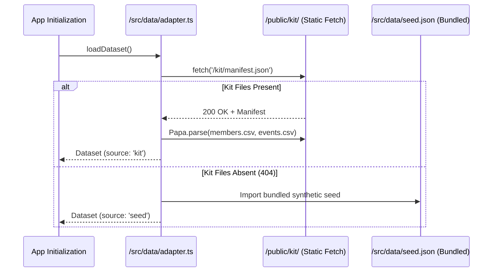

# Technical Requirements Document (TRD)
## Otterly Safe: Frontend Architecture, Deterministic Engine & Security Model

**Document Version:** 1.0.0  
**Stack:** React 18 + TypeScript + Vite 5 + Tailwind CSS + Zustand + Vitest  
**Target:** Client-Side Single Page Application (Static Distribution, 100% Offline Capable)

---

## 1. System Architecture & Component Hierarchy

Otterly Safe is architected as an un-opinionated, reactive client-side application. It relies entirely on structured in-memory datasets (`/src/data/seed.json` or `/public/kit/`), pure functional business logic, and modular presentation tiers.

```
src/
├── components/
│   ├── demo/
│   │   ├── DemoStage.tsx          # Master orchestration stage
│   │   ├── PresenterBar.tsx       # Presentation controls & keyboard navigation
│   │   ├── PersonaRail.tsx        # Persona profile selection sidebar
│   │   └── DataDrawer.tsx         # Raw JSON/ledger event inspector
│   ├── payment/
│   │   ├── PayAnyoneForm.tsx      # Standard member transfer input
│   │   ├── ReviewScreen.tsx       # Pre-send review screen
│   │   ├── OllieCheckSheet.tsx    # Signature 30s scam intervention sheet
│   │   ├── RememberThisCard.tsx   # Practice-to-payment recall card
│   │   ├── CheckQuestions.tsx     # 3 yes/no targeted questions
│   │   ├── ChoiceBar.tsx          # Zero-bypass exit actions
│   │   ├── SendTimeCard.tsx       # Look-alike scheduled cutoff card
│   │   ├── OwnRulePrompt.tsx      # Member custom rule creator
│   │   ├── LockdownCard.tsx       # Takeover freeze screen
│   │   └── RecoveryPath.tsx       # No-blame restorative care path
│   ├── practice/
│   │   ├── PracticeTab.tsx        # Container for interactive training
│   │   ├── ScamOrLegitDeck.tsx    # 8 card drill with ClueSpotlight
│   │   ├── ClueSpotlight.tsx      # In-line red-flag numbering component
│   │   ├── RolePlayChat.tsx       # Branching caller role-play
│   │   ├── RedFlagHunt.tsx        # 4 hidden clues spotting drill
│   │   ├── QuickQuiz.tsx          # 5-question defensive quiz
│   │   ├── ShellBadges.tsx        # Gamified completion badges
│   │   └── OfficialAlertCard.tsx  # FTC/DFI advisory card
│   ├── staff/
│   │   ├── StaffConsole.tsx       # Dual-mode (panel & tab) staff station
│   │   ├── RecallClock.tsx        # Textual legal recall timeline
│   │   ├── CallScript.tsx         # 3-line member verification script
│   │   └── MemberTimeline.tsx     # Monospace chronological audit feed
│   ├── tabs/
│   │   ├── RulesLab.tsx           # Sandbox tuning & persona matrix
│   │   ├── PilotPlan.tsx          # 90-day phased rollout spec
│   │   └── PrivacyAccess.tsx      # Privacy charter & accessibility audit
│   ├── Ollie.tsx                  # 5-mood original inline SVG mascot
│   ├── OllieBubble.tsx            # Accessible speech bubble (aria-live)
│   ├── PhoneFrame.tsx             # 390×844 mobile device viewport
│   ├── SoundAppShell.tsx          # Mobile banking wrapper with wordmark
│   └── SmsThread.tsx              # Second phone trusted contact SMS display
├── data/
│   ├── adapter.ts                 # Starter kit CSV/JSON auto-detector
│   ├── cards.json                 # 8 bilingual practice drill cards
│   ├── practiceExtra.ts           # Role-play turns, quiz, hunt data
│   └── seed.json                  # Deterministic 90-day banking history
├── lib/
│   └── format.ts                  # Pacific time pinned clock/money utilities
├── rules/
│   ├── config.ts                  # Threshold constants (R2, R3, R5, R6)
│   ├── engine.ts                  # Pure mathematical evaluation functions
│   └── engine.test.ts             # Vitest test suite (100% lane coverage)
├── store/
│   └── useStore.ts                # Zustand reactive application store
├── types.ts                       # Universal TypeScript domain interfaces
├── App.tsx                        # Top navigation, wordmark & tab routing
└── main.tsx                       # React 18 DOM mount entrypoint
```

---

## 2. Rules Engine Formal Specification

The rules engine (`/src/rules/engine.ts`) evaluates transactions using **pure, deterministic functions**. It prohibits black-box machine learning models, external API dependencies, and non-reproducible calculations.

### 2.1 Rule Definitions

$$\text{Evaluate}(tx, M, H, C) \rightarrow \{ \text{lane}, \text{reasons}, \text{evidence}, \text{fired}, \text{paused} \}$$

- **R1 (First Payment to Recipient):**
  $$R_1 \iff tx.\text{new\_recipient} = \text{true} \land tx.\text{amount} \ge C.\text{reviewFloor}$$
- **R2 (Multiple of Usual Payment):**
  $$R_2 \iff tx.\text{amount} \ge C.\text{reviewFloor} \land \frac{tx.\text{amount}}{M.\text{usual\_payment}} \ge C.\text{r2Multiple}$$
- **R3 (Share of Account Balance):**
  $$R_3 \iff tx.\text{amount} \ge C.\text{reviewFloor} \land \frac{tx.\text{amount}}{\text{balance\_before}} \ge C.\text{r3Share}$$
- **R4 (Irreversible Payment Channel):**
  $$R_4 \iff tx.\text{amount} \ge C.\text{reviewFloor} \land tx.\text{payment\_type} \in \{\text{'wire'}, \text{'p2p'}\}$$
- **R5 (Recent Account Credential Change):**
  $$R_5 \iff \exists e \in H \text{ s.t. } e.\text{type} \in \{\text{'password\_reset'}, \text{'phone\_change'}, \text{'email\_change'}\} \land (t_{tx} - t_e) \le C.\text{r5WindowHours}$$
- **R6 (New Large Deposit Followed by Outflow):**
  $$R_6 \iff tx.\text{new\_recipient} \land \exists d \in H \text{ s.t. } d.\text{type} = \text{'deposit'} \land d.\text{amount} \ge C.\text{r6LargeDeposit} \land (t_{tx} - t_d) \le C.\text{r6WindowHours} \land d.\text{is\_new\_source}$$
- **R7 (Post-Hold Evasion or Retry):**
  $$R_7 \iff \exists h \in H \text{ s.t. } h.\text{status} = \text{'held'} \land (\text{same payee} \lor tx.\text{retry\_of} = h.\text{event\_id})$$

### 2.2 Lane Decision Truth Table

```
LANE SELECTION LOGIC:
1. IF R5 AND new_recipient AND (R2 OR R3):
     LANE = Takeover
     PAUSED = TRUE
2. ELSE IF (NOT Takeover) AND ((R1 AND R4 AND (R2 OR R3)) OR R6 OR R7):
     LANE = Scam Signs
     PAUSED = TRUE
3. ELSE IF (R1 OR R2):
     LANE = Look-Alike
     PAUSED = TRUE (unless covered by Member Own Allow Rule)
4. ELSE:
     LANE = Normal
     PAUSED = FALSE
```

### 2.3 Member Rule Asymmetry Invariant
- **Rule Softening Constraint:** A member's custom rule (e.g. `allow_category_up_to: 6000` for contractors) can **only soften the Look-Alike lane**.
- **Security Boundary:** A member custom rule **never** softens, suppresses, or bypasses the `Takeover` or `Scam Signs` lanes.

---

## 3. Data Flow & Adapter Architecture

To support both synthetic demo generation and live competition starter kit files, `/src/data/adapter.ts` operates an asynchronous auto-discovery pipeline:



---

## 4. Privacy, Security & Threat Model

### 4.1 Strict Data Boundary
- **Allowed:** Transaction amounts, channel, counterparty ID, timestamps, account balances, password reset timestamps, opt-in contact names.
- **Strictly Prohibited:** Keystroke dynamics, camera/microphone streams, location geofencing, reading member SMS/email content, contact list harvesting, third-party data broker feeds.

### 4.2 Role-Based Data Isolation
- **Trusted Contact Privacy:** The second phone SMS notification receives zero financial metrics. Payload strictly contains:
  ```json
  {
    "to": "Maya (daughter)",
    "message": "Sound paused a payment for Anchor A. Please call them on a number you already have. Don't click links."
  }
  ```
  No balance or dollar amounts are leaked to third parties.

---

## 5. Accessibility Engineering (WCAG 2.2 AA)

1. **Color Contrast:**
   - `navy-900` on `sand-50`: Contrast ratio **14.8:1** (exceeds AAA requirement).
   - `kelp-700` on `white`: Contrast ratio **5.5:1** (exceeds AA requirement).
   - `check-700` on `check-50`: Contrast ratio **4.6:1** (paired with warning icon and bold text).
2. **Accessible Name & Focus Ring:** Every interactive element has an `aria-label` or visible text label. Keyboard focus is marked by a prominent `3px solid #0F766E` ring with `2px` offset.
3. **Screen Readers:** Ollie's dialogue bubbles are bound to `role="region"` and announced via `aria-live="polite"` with `aria-atomic="true"`.
4. **Motion Preference:** The `@media (prefers-reduced-motion: reduce)` media query collapses all animations to `0.01ms`.

---

## 6. Testing Strategy

- **Test Runner:** Vitest 2.1
- **Command:** `npm test`
- **Coverage Matrix:**
  1. `Takeover Lane`: Profile change + new payee + large payment.
  2. `Scam Signs Lane`: $9,800 wire to new payee (R1+R2+R3+R4).
  3. `Scam Signs (R6 variant)`: Fake check deposit followed by quick payment.
  4. `Scam Signs (R7 variant)`: Smaller retry to same payee after a hold.
  5. `Look-Alike Lane`: First payment to roofing contractor.
  6. `Look-Alike Softening`: Member own rule exemptions.
  7. `Normal Lane`: Routine transfers bypassing rules.
  8. `Missed Scam`: Repeat small transfers to existing platforms.
  9. `Exclusions`: Internal transfers between member's own accounts never pause.
